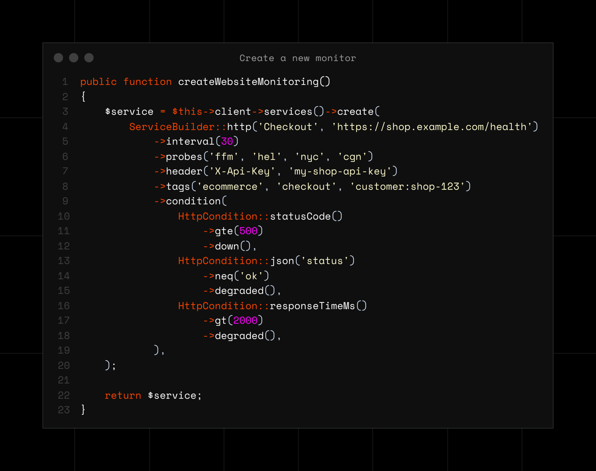

# LIVCK Cloud for Laravel



Laravel integration for [LIVCK Cloud](https://livck.cloud): uptime monitoring and status pages
on [statuspage.de](https://statuspage.de) or your own domain. It builds on the
[LIVCK Cloud PHP SDK](https://github.com/LIVCK/cloud-php#readme) (`livck/cloud-php`) and adds
configuration, a facade, dependency injection, several connections, heartbeats for the
scheduler and the queues, a fake for tests and an Artisan check. The API itself, with its
builders, queries, DTOs, retries and exceptions, is the SDK's; its README covers all of it.

## Requirements

- PHP 8.3 or later
- Laravel 12 or 13
- An API token of your organization (`lvk_…`, under *Settings → Organization → API tokens*).
  API access starts with the Team plan.

## Installation

```bash
composer require livck/cloud-laravel
```

Laravel discovers the service provider and the `LivckCloud` facade. Put the token into `.env`:

```dotenv
LIVCK_CLOUD_TOKEN=lvk_…
```

and check the connection:

```bash
php artisan livck-cloud:check
```

To change more than the token, publish the configuration to `config/livck-cloud.php`:

```bash
php artisan vendor:publish --tag=livck-cloud-config
```

## Usage

The facade speaks for the default connection:

```php
use LIVCK\Cloud\Builders\ServiceBuilder;
use LIVCK\Cloud\Laravel\Facades\LivckCloud;

$tag = LivckCloud::tags()->ensure('customer', '4711')->tag;

LivckCloud::services()->create(
    ServiceBuilder::http('Shop', 'https://shop.example.com')->interval(60)->tags($tag),
);
```

Or type against the SDK's interface and let the container inject it, into a controller's
constructor or a job's `handle()`:

```php
use LIVCK\Cloud\CloudClientInterface;

final class ProvisionCustomer implements ShouldQueue
{
    use Dispatchable, Queueable;

    public function __construct(public readonly string $customer) {}

    public function handle(CloudClientInterface $cloud): void
    {
        $cloud->tags()->ensure('customer', $this->customer);
    }
}
```

Only the job's data is queued; the worker injects the client when the job runs.

## Several organizations

A reseller serving several organizations gives each its own connection and token:

```php
// config/livck-cloud.php
'connections' => [
    'default' => [
        'token' => env('LIVCK_CLOUD_TOKEN'),
        // …
    ],
    'customer-b' => [
        'token' => env('LIVCK_CLOUD_TOKEN_CUSTOMER_B'),
        'locale' => 'de',
    ],
],
```

```php
LivckCloud::connection('customer-b')->services()->list();
```

A key a connection leaves out takes the SDK's default.

## Tokens from your database

A reseller who keeps one token per end customer in their own database needs no connection for
each. `withToken()` takes the settings of the default connection, or of the connection named
second, with another token:

```php
LivckCloud::withToken($customer->livck_token)->services()->list();
```

`build()` takes the keys of a connection. What it leaves out comes from the default connection,
the token included; a key it passes wins, even with `null`. An unknown key throws, so a typo
cannot go unnoticed:

```php
$cloud = LivckCloud::build([
    'token' => $customer->livck_token,
    'locale' => $customer->locale,
]);
```

A blank token throws `MissingTokenException` instead of falling back to a configured one, so a
customer without a token never reaches your own organization. Store the tokens with Laravel's
`encrypted` cast, which keeps them out of the database in plain text:

```php
protected function casts(): array
{
    return ['livck_token' => 'encrypted'];
}
```

Each call builds a new client and the manager keeps none; an Octane or queue worker would
otherwise hold a client for every customer's token for as long as it runs. Hold the client in
a variable for the request or job at hand rather than calling `withToken()` again for each API
call. `LivckCloud::fake()` covers both, see [Testing](#testing).

## Servers of your customers

A server is monitored by the LIVCK agent and enrolls with an enrollment key. Create one `single`
key per server with the customer's tag: the key's tags are the server's, and the install
cannot replace them (in a reseller organization it cannot add any either). The key and its
install command come back this once:

```php
use LIVCK\Cloud\Builders\EnrollmentKeyBuilder;
use LIVCK\Cloud\Laravel\Facades\LivckCloud;

$created = LivckCloud::enrollmentKeys()->create(
    EnrollmentKeyBuilder::single("Customer {$customer->number}")->tags("customer:{$customer->number}"),
);

$order->update(['livck_enrollment_key' => $created->key->id]);

return $created->installCommand->reveal(); // the customer runs it on the server, as root
```

A single key is valid for 24 hours unless you set `expiresAt()`. Poll it, from a scheduled job
for instance, until it names the new server:

```php
$server = LivckCloud::enrollmentKeys()->get($order->livck_enrollment_key)->latestService();

if ($server !== null) {
    $order->update(['livck_service' => $server->id]);
}
```

Ask for the server, not for the status, which only says whether the key can still enroll one.
A key that can no longer enroll is deleted once it is more than 30 days old. The customer's tag
may also fill the customer's synced status page group: the server carries it, but synced groups
leave servers out, so it never shows on the page.

The key and the install command are secrets: dumps, logs and JSON never show them, and
serializing them throws, so a queued job takes the key's id rather than the created result.
With `transport: 'laravel'` and Telescope's HTTP client watcher, hide them there as well:
`Telescope::hideResponseParameters(['data.token', 'data.install_command'])`.

## Heartbeats for scheduled tasks and queues

A LIVCK heartbeat watches a job from the inside: the job calls the heartbeat's ping URL when it
starts and when it ends, and LIVCK raises an incident when a run fails or a ping does not come
in time. The package does the calling for the tasks of your schedule, for scheduled queue jobs,
for the queues themselves and for code of your own.

Mark the tasks in `routes/console.php`:

```php
use Illuminate\Support\Facades\Schedule;

Schedule::command('export:nightly')->dailyAt('03:00')->heartbeat();
Schedule::job(new SyncOrders)->everyFiveMinutes()->heartbeat();
Schedule::call(fn () => Report::build())->hourly()->heartbeat('report:build', maxDuration: 900);
Schedule::exec('/usr/local/bin/backup.sh')->daily()->heartbeat('backup');
```

Each heartbeat has a key (`export:nightly`, `job:sync-orders`, see [Keys](#things-to-know)) and
needs a ping URL. The quickest way to get them is an API token: the package declares the
heartbeats and LIVCK hands back the URLs. Without the API, you copy the URLs into the
configuration.

### With an API token

1. In LIVCK, create an API token under *Settings → Organization → API tokens* with the
   permission `heartbeats.declare` ("Declare heartbeats"), as a member who sees the whole
   organization (see [Access areas](#things-to-know)).
2. Put it into `.env` as `LIVCK_CLOUD_TOKEN=lvk_…`.
3. Deploy. The next scheduler run declares the heartbeats (`POST /v1/heartbeats/declare`):
   LIVCK creates the ones it does not know, keeps the others in line with the code and hands
   back their ping URLs, which are pinged right away.

A running `php artisan schedule:work` hands the environment it read at its start to every run,
so it does not see a token added to `.env` later: restart it after changing the token. A cron
entry that calls `schedule:run` reads `.env` anew every minute.

`php artisan livck-cloud:check` says whether the token may declare, and
`php artisan livck-cloud:heartbeats` shows what was declared.

What gets declared is the application (`heartbeats.app`, or `app.name` as a slug), the
environment (`app()->environment()`) and per key its kind, its schedule and the options of
`->heartbeat()`. LIVCK finds each heartbeat again by application, environment and key, so
staging and production never share one, and tags it with both. The values the code sends
belong to the code and are locked in LIVCK; what it leaves out (name, alerting, a grace you did
not set) stays as you set it there. A new heartbeat waits for its first ping before it can go
down.

### Ping URLs by hand

Create the heartbeat in LIVCK with the same schedule and options and put its ping URL into the
configuration under the task's key. This works on every plan and never calls the API:

```php
// config/livck-cloud.php
'heartbeats' => [
    'environments' => ['production'],
    'urls' => [
        'export:nightly' => env('LIVCK_HEARTBEAT_EXPORT_NIGHTLY'),
        'job:sync-orders' => env('LIVCK_HEARTBEAT_SYNC_ORDERS'),
    ],
],
```

Both ways mix: a key with a URL in the configuration is pinged at exactly that URL and left out
of the declaration, every other key is declared. A key with neither is not pinged, and the log
says so.

### Scheduled queue jobs

A job with `ShouldQueue` is pinged by the worker that runs it, not by the scheduler: queueing
it says nothing about whether it ran. The scheduler marks the one job it queues, and the worker
pings success once the job has finished, with the time that attempt took as the figure
`duration`, and `/fail` when the last attempt has failed. It sends no `/start`: when a worker
picks a job up, nobody knows yet whether it runs or puts itself back, and a start would count
as a run. A job that releases itself (`release()`, `WithoutOverlapping`, `RateLimited`) and an
attempt that is retried send nothing, so a job that only ever puts itself back is reported as
late once its grace is over, and as up again once it really runs. A job that runs out of
attempts sends `/fail`. The same job dispatched anywhere else, and every job a scheduled job
dispatches, carries no mark and is never pinged.

Without a start there is nothing for `maxDuration` to measure, so a queued job does not
declare it: `->heartbeat(maxDuration: …)` on such a job is left out of the declaration, and
`livck-cloud:heartbeats` and the log say so. The job is watched all the same; its grace covers
a run that takes long. Laravel's own `timeout` on the job ends a run that hangs.

A unique job (`ShouldBeUnique`) is not queued again while its lock is held, and without
`uniqueFor` that lock never expires. Give such a job a `uniqueFor`, so that one lost from the
queue does not stop it for good.

### Queue pulse

To watch the queues themselves, name them:

```php
'heartbeats' => [
    'queues' => ['default', 'mails', 'sqs' => ['reports']],
],
```

Every minute the scheduler puts a tiny job into each queue, at most one per queue at a time;
there is nothing to write in `routes/console.php`. When a worker runs it, it pings the queue's
heartbeat with the time the pulse waited as the figure `wait_seconds`. When no worker takes the
pulse, the pings stop. A queue of the default queue connection is `queue:<name>`, one of
another connection `queue:<connection>:<name>` (`queue:sqs:reports`). With a token these
heartbeats are declared with a period of one minute and a grace of 120 seconds
(`heartbeats.queue_grace`, at least 30); by hand, give them that period and grace in LIVCK and
put their URLs under `heartbeats.urls`.

With LIVCK's default for a period of one minute, two missed periods in a row, a queue is
reported down about four minutes after its last pulse (60 + 120 seconds to the first missed
period, 60 more to the second), give or take the 15 seconds between two checks in LIVCK. A
short `php artisan down`, during which neither the scheduler sends pulses nor `queue:work`
takes jobs, or a deploy that restarts the workers, passes without an alarm, as it does for a
task that runs every minute. A larger grace waits longer before it reports a dead worker.

### Your own pings

A job outside the schedule, a daemon for instance, pings a heartbeat by its key:

```php
$heartbeat = LivckCloud::heartbeat('import');

$heartbeat->start();
$heartbeat->exitCode($code); // 0 is a success
```

`start()`, `success()`, `fail()` and `exitCode()` return the SDK's `PingResult` and never throw.
The URL comes from `heartbeats.urls` or, for a declared heartbeat, from the cache. To have such
a heartbeat declared, give the most seconds you expect between two pings:

```php
'heartbeats' => [
    'custom' => [
        'import' => 3600,
    ],
],
```

It is declared as kind `custom` with that period. A key of `heartbeats.urls` that nothing in
the schedule has is listed as `custom` without a schedule.

### Commands

```bash
php artisan livck-cloud:heartbeats
```

lists every heartbeat the package found in the schedule and the configuration, with its kind,
its schedule, whether it is declared or has a URL in the configuration, and where its ping URL
comes from right now (`config`, `cache` or `none`). Above the list it says whether the last
declaration matches the code, differs from it, is paused (and why) or never ran; below it, the
tasks it cannot watch and the options it leaves out, and why. It sends nothing.

```bash
php artisan livck-cloud:heartbeats:sync --env=production
```

declares now, from a deploy or CI step, whatever the cache says, and shows per key whether
LIVCK created, updated or left it unchanged, what it could not create and why, and, under its
own heading, the heartbeats that are in LIVCK but no longer in the code. It exits with `0` only
when LIVCK accepted the list and every heartbeat exists, `1` when it did not, and `2` when
nothing can be declared from here (no token, heartbeats off in this environment). It runs with
the connection's own timeout and retries. `--dry-run` shows what would be sent and sends
nothing (`-v` adds the request body), and says when a run from here would declare nothing. Run it in the environment the scheduler runs in: a
heartbeat declared for another environment is one nothing pings.

### Testing heartbeats

`LivckCloud::fake()` (see [Testing](#testing)) records heartbeat pings instead of sending them,
whether a ping URL is configured or not, and turns heartbeats on in the test's environment:

```php
it('pings the export heartbeat', function () {
    $fake = LivckCloud::fake();

    $this->artisan('schedule:run');

    $fake->assertPinged('export:nightly');
    $fake->assertNotPinged('report:build');
});
```

`assertPinged()` without signals checks for any ping; with signals, for exactly these in this
order, an exit code as a string (`'3'`). `assertNothingPinged()` completes the set, and
`pings('export:nightly')` lists what a key got, figures included (`metrics()`).

`schedule:run` starts a scheduled command the way it does in production: as
`php artisan export:nightly` in a process of its own. That process is not part of the test. It
runs the command for real, without the test's fakes, and against a database of its own (an
in-memory SQLite database is empty there). The ping after `start` is its exit code, so expect
`success` only from a task that runs inside the test, a closure (`call`) or a job the scheduler
runs itself, and test what a command does by running it with `$this->artisan()`.

The fake answers declarations as LIVCK would, without a token: every key exists, with a ping URL
of its own, and the pings that follow use it. A key an earlier declaration of the same test
named and this one does not comes back as unlisted.

```php
it('declares the scheduled tasks', function () {
    $fake = LivckCloud::fake();

    $this->artisan('livck-cloud:heartbeats:sync')->assertSuccessful();

    $fake->assertDeclared('export:nightly', 'job:sync-orders');
    $fake->assertNotDeclared('report:build');
});
```

`assertDeclared()` without keys checks that anything was declared; with keys, that one
declaration named each of them. `assertNothingDeclared()` completes the set, and
`declarations()` lists every declaration with its body (`keys()`, `heartbeat('export:nightly')`).
The scheduler declares on the event the `artisan` binary fires when `schedule:run` starts;
Laravel does not fire it for `$this->artisan()` in tests, so test the declaration with the
sync command.

### Things to know

**Keys.** A command is known by its name without arguments (`export:nightly`), a job by
`job:` and its class name in lower case with hyphens (`SyncOrders` is `job:sync-orders`). A
closure (`call`) and a shell command (`exec`) need a key of their own: `->heartbeat('backup')`.
So does a command that is scheduled twice, with each run getting its own key. A task without
a usable key is not pinged; `livck-cloud:heartbeats` and the log name it, and nothing throws.

**What is sent.** For a command, a closure and a shell command: `/start` before the task, then
success or, for a task that failed, its exit code (`/3`). A closure that throws or returns
`false` ends with `1`. Tasks run with `runInBackground()` are pinged as well: their end is
reported from `schedule:finish`, the process Laravel runs when the task is done. A job without
`ShouldQueue`, which the scheduler runs itself, is pinged like a command. A queued job gets no
`/start`, see [Scheduled queue jobs](#scheduled-queue-jobs).

**Options.** `->heartbeat(?string $key, ?int $grace, ?int $maxDuration, ?int $every, ?int $tolerance)`.
Grace (seconds a ping may be late), max duration (seconds between start and end, not for
queued jobs) and tolerance (missed pings in a row before the heartbeat is down) are part of
the declaration. An option you
leave out keeps the value the heartbeat has in LIVCK. Where `->heartbeat()` stands in the chain
does not matter: cron, timezone and conditions are read when the package needs them.

**Tasks under a condition.** For a task with `when()`, `skip()`, `between()` or
`unlessBetween()` the cron does not say when it really runs. Name the longest gap you expect,
in seconds, and the heartbeat expects a ping at least that often:

```php
Schedule::command('feed:pull')->everyMinute()->when(fn () => Feed::enabled())->heartbeat(every: 3600);
```

Without `every:` such a task is not pinged and shows up as a problem. `withoutOverlapping()` is
no condition.

**Environments.** The package is active only in the environments of `heartbeats.environments`
(`production` by default). Anywhere else it adds no hooks, no listeners and no queue pulse, and
sends nothing. A task that does not run in the current environment (`->environments()`) is left
out silently.

**Maintenance mode.** After `php artisan down` Laravel skips scheduled tasks without a trace,
unless they run `evenInMaintenanceMode()`. No ping is sent for a skipped task, so the heartbeat
reports it as late once its grace is over. The queue pulse pauses as well. With the defaults a
task that runs every minute and the pulse both outlast up to two minutes of `artisan down`;
from about three minutes on, LIVCK reports an outage. For longer work, schedule a maintenance
in LIVCK.

**Never in the way.** A ping takes at most three seconds (`heartbeats.timeout`) and is never
retried. When LIVCK cannot be reached, the process sends no ping for a minute rather than
waiting three seconds for each. Nothing the package does throws into a task, a job or the
scheduler; problems go to the log (`log_channel`, or the default channel).

**When the scheduler declares.** Once per `schedule:run`, before any task, and only when the
list differs from the one LIVCK last accepted, so on a normal minute it sends nothing; a cache
lock keeps two servers from declaring at once. Queue workers and web requests never declare: a
worker that runs since the last deploy still holds the old list and would write it back.
Normally the package needs one call of the declare endpoint per change of the list, far below
the limit LIVCK sets per token, above which it answers 429 (see below).

**When a declaration fails.** It never holds up the schedule for long and never throws: it
takes at most three seconds (`heartbeats.declare_timeout`) and is not retried. The ping URLs
known so far are pinged meanwhile, the log says what to do, and the scheduler tries again:

| Answer | Next try |
|---|---|
| no answer, timeout, 5xx | after 60 seconds |
| 429 | after `Retry-After` |
| 409 (another declaration at the same moment) | next scheduler run |
| 401 (token unknown, revoked or expired) | after 15 minutes |
| 403 (token lacks `heartbeats.declare`) | after 15 minutes |
| 403 (token sees only part of the organization) | after 15 minutes |
| 403 (plan without API access) | after 15 minutes |
| 422 (LIVCK refused the list) | once the list changes |

A heartbeat the plan has no room for is not created; the others are declared all the same, the
log says how many services are missing, and the scheduler tries again every 15 minutes.

**A task removed or renamed.** LIVCK never deletes or pauses a heartbeat because the code no
longer names it: the heartbeat stays and reports an outage once its ping stays away. The log
and `livck-cloud:heartbeats:sync` name it ("in LIVCK, no longer in the code"). Delete the
heartbeat in LIVCK when you removed or renamed its task. A renamed key is a new heartbeat.

**A heartbeat deleted in LIVCK while its task is still in the code** is created anew: the next
ping gets a 404, the package drops the URL, and the next scheduler run (at most once every ten
minutes for this reason) declares the list again. The same happens after you renew a ping URL
in LIVCK. The new heartbeat waits for its first ping.

**Plans.** Declaring uses the API, so it needs a plan with API access (Team and up); ping URLs
in the configuration, and those a declaration returned, work on every plan. When the
organization moves to a plan without API access, LIVCK changes nothing about the heartbeats:
declaring answers 403, the log says so, and the package keeps pinging the URLs it knows. A new
task gets no heartbeat, and once the cache is cleared the URLs are gone and the heartbeats
report an outage. Put the ping URLs into `heartbeats.urls` to keep them without the API.

**Access areas.** Declared heartbeats belong to the whole organization, not to an access area.
A token sees what the member who created it sees (and nothing once that member has left), so a
token of a member whose view is limited by access areas may not declare: LIVCK answers 403, and
more permissions do not help. Use a token of a member who sees the whole organization. A new
heartbeat lies in no access area; whoever sees everything can tag it so that an area shows it.

**Scheduler and workers share the cache.** The ping URLs from a declaration, what the package
remembers about the last declaration, and the pulse's lock live in the cache. The workers ping
scheduled jobs and the pulse with URLs the scheduler stored there, so both need the same cache
store, as `queue:restart` and `onOneServer()` need it anyway. `heartbeats.cache_store` names the
store, the default one when null; the URLs are encrypted with the application key. Workers read
the configuration when they start: restart them (`queue:restart`) after changing it.

## Configuration

| Key | Default | Notes |
|---|---|---|
| `default` | `default` | The connection of the facade and of an injected client |
| `connections.*.token` | `LIVCK_CLOUD_TOKEN` | Required outside of tests |
| `connections.*.base_uri` | `https://api.livck.cloud/v1` | https; plain http only for loopback hosts |
| `connections.*.timeout`, `connect_timeout` | 30 s, 10 s | |
| `connections.*.max_retries` | 2 | Attempts after the first; 0 turns retries off |
| `connections.*.max_retry_after` | 60 s | A longer `Retry-After` fails at once instead of waiting |
| `connections.*.idempotency` | `true` | An `Idempotency-Key` on every POST |
| `connections.*.locale` | none | `Accept-Language`; `app` sends the application's locale of the moment |
| `connections.*.user_agent_suffix` | none | Appended to the User-Agent, e.g. `my-panel/2.3` |
| `connections.*.transport` | `sdk` | `laravel` sends through Laravel's HTTP client, see below |
| `log_channel` | none | One debug line per attempt; never a token, never a body |
| `catalog_cache.store`, `ttl` | default store, 3600 s | For `LivckCloud::catalog()`; a TTL of 0 turns it off |
| `heartbeats.app` | `app.name` as a slug | The application's name in LIVCK (`LIVCK_CLOUD_APP`) |
| `heartbeats.environments` | `['production']` | Where heartbeats are active |
| `heartbeats.queues` | none | Queues the pulse watches, see [Queue pulse](#queue-pulse) |
| `heartbeats.queue_grace` | 120 s | Grace of each queue's heartbeat, at least 30 (`LIVCK_CLOUD_HEARTBEAT_QUEUE_GRACE`) |
| `heartbeats.custom` | none | Seconds between two pings by key, for [your own pings](#your-own-pings) |
| `heartbeats.urls` | none | Ping URLs by heartbeat key |
| `heartbeats.timeout` | 3 s | For each ping (`LIVCK_CLOUD_HEARTBEAT_TIMEOUT`); never retried |
| `heartbeats.declare_timeout` | 3 s | For the scheduler's declaration (`LIVCK_CLOUD_HEARTBEAT_DECLARE_TIMEOUT`); never retried |
| `heartbeats.cache_store` | default store | Shared by scheduler and workers (`LIVCK_CLOUD_HEARTBEAT_CACHE_STORE`) |

The shipped configuration reads every key of the default connection from `LIVCK_CLOUD_` and
the key in upper case (`LIVCK_CLOUD_BASE_URI`, `LIVCK_CLOUD_TRANSPORT`, …), the others from
`LIVCK_CLOUD_LOG_CHANNEL`, `LIVCK_CLOUD_CATALOG_CACHE_STORE`, `LIVCK_CLOUD_CATALOG_CACHE_TTL`
and, for the name of the default connection, `LIVCK_CLOUD_CONNECTION`. The log channel needs
the `debug` level to show anything.

`LivckCloud::catalog()` returns the check-type catalog from the cache, fetched once per
connection, base URI and locale. Hand it to `services()->create()` to validate builders
without a request each; `LivckCloud::checkTypes()` always asks the API.

## Checking a connection

`php artisan livck-cloud:check [connection]` calls `GET /v1/me` and shows the organization,
the token's type, abilities and expiry, and the rate limit. `/v1/me` answers any valid token,
so the check then lists the monitoring locations to prove the plan includes API access (with a
token that has `services.view`). When the scheduler would declare heartbeats through the
connection, it also says whether the token has `heartbeats.declare`. It exits with `0` when the
connection works, `1` when the API rejects the token (unknown, revoked, a plan without API
access), cannot be reached, or the token cannot declare the heartbeats, and `2` when the
configuration is incomplete. `php artisan about` lists the connections with their
base URI and the beginning of each token, never the token itself.

## Testing

`LivckCloud::fake()` swaps every connection for the SDK's fake: the facade, injected clients,
named connections and clients from `withToken()` and `build()` all answer from one queue,
nothing leaves the process, and retries do not sleep. No configured token is needed; a blank
one passed to `withToken()` or `build()` still throws.

```php
use LIVCK\Cloud\Laravel\Facades\LivckCloud;
use LIVCK\Cloud\Testing\MockResponse;
use LIVCK\Cloud\Testing\RecordedRequest;

it('tags a new customer in their own organization', function () {
    $fake = LivckCloud::fake([
        MockResponse::json(['data' => $tagPayload], 201),
    ]);

    ProvisionCustomer::dispatchSync('4711');

    $fake->assertSent(fn (RecordedRequest $request, string $connection) =>
        $connection === 'default' && $request->matches('POST', '/v1/tags/ensure'));
});
```

The matcher receives the request and the name of its connection: `ondemand`
(`CloudFake::ON_DEMAND`) for a client from `withToken()` or `build()`. `assertNotSent()`,
`assertSentCount()` and `assertNothingSent()` complete the set; these four work on the facade
as well (`LivckCloud::assertSent(…)`). `assertNoPendingResponses()` checks that every queued
response was used, and `recorded('customer-b')` lists one connection's requests. A request
without a queued response throws, so a test never sends more than it planned for. Call
`fake()` before the code under test resolves a client.

Heartbeat pings and declarations have assertions of their own, see
[Testing heartbeats](#testing-heartbeats).

## Laravel's HTTP client

With `transport: 'laravel'` (`LIVCK_CLOUD_TRANSPORT=laravel`) a connection sends through
Laravel's HTTP client. `Http::fake()` then answers its requests, `Http::preventStrayRequests()`
refuses them, `Http::assertSent()` sees them, Pulse records slow ones and Telescope lists them
(with the `Authorization` header hidden, as Telescope hides it by default). Retries,
idempotency and error mapping stay with the SDK; `Http::globalOptions()` does not apply, the
connection's timeouts do. `LivckCloud::fake()` takes precedence over both transports.

## Octane and queue workers

The clients are immutable and hold no request state, so the manager builds each connection
once and every request of an Octane worker and every job of a queue worker reuses it. It reads
configuration and locale from the application of the moment, so with `locale: 'app'` each
request gets its own language. Resolve such a client where you use it (the facade, a
controller, a job) rather than into a singleton built while the application boots, and call
`LivckCloud::purge()` after changing a connection at runtime. Clients from `withToken()` and
`build()` are never kept, see [Tokens from your database](#tokens-from-your-database).

## User-Agent

Every request names the SDK, then this package and the Laravel version, then your suffix:

```text
livck-cloud-php/1.2.0 PHP/8.4.1 livck-cloud-laravel/1.2.0 Laravel/13.2.0 my-panel/2.3
```

## Links

- SDK: [livck/cloud-php](https://github.com/LIVCK/cloud-php#readme)
- Documentation: [docs.livck.cloud](https://docs.livck.cloud)
- API reference: [api.livck.cloud](https://api.livck.cloud)
- Status pages: [statuspage.de](https://statuspage.de)

## License

MIT. See [LICENSE](LICENSE).
